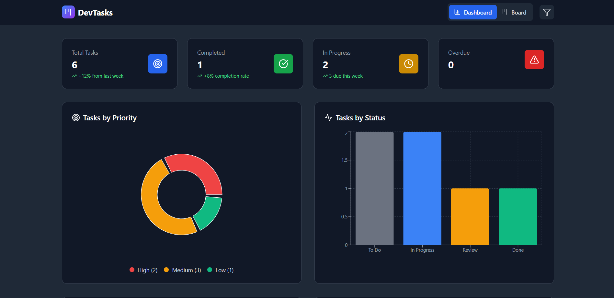
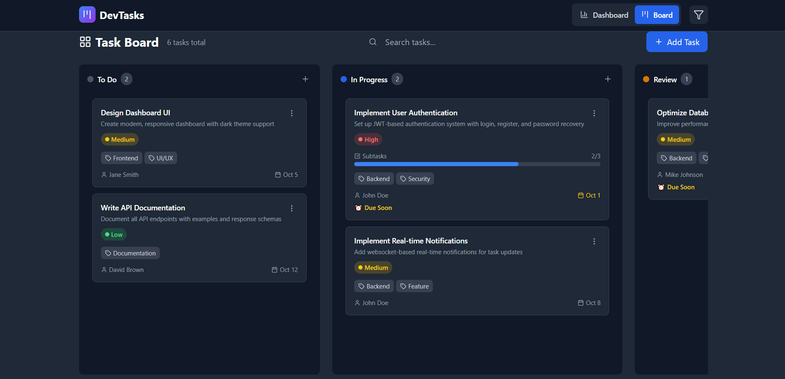
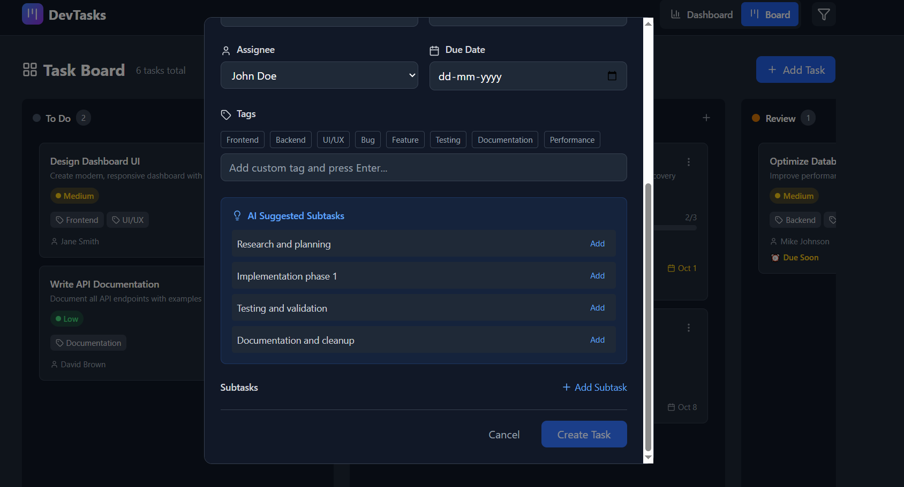

# 🚀 DevTasks

_A smart, interactive task manager for developers to plan, track, and optimize their workflow._

---

## 📑 Table of Contents

<details>
  <summary><strong>🔎Click to expand.👇</strong></summary>

  - [✨ Overview](#-overview)
  - [🧰 Core Features](#-core-features)
  - [🖼️ Screenshots](#️-screenshots)
  - [🏗️ Tech Stack](#️-tech-stack)
  - [⚙️ Installation & Setup](#️-installation--setup)

  </details>

---

## ✨ Overview

**DevTasks** is a modern task management web app built with **React + TypeScript + Tailwind CSS** that showcases **advanced frontend engineering skills**.  
It combines a **drag-and-drop Kanban board**, **AI-powered task suggestions**, and **real-time collaboration features** to give developers a smarter way to manage their workflow.

This project demonstrates:
- Proficiency in **React ecosystem** (hooks, context, reducers, performance optimization).
- UI/UX design with **Tailwind CSS + Framer Motion**.
- State management with **Redux Toolkit / Context API**.
- Integration with external APIs (AI suggestions, Firebase).
- Clean code, scalability, and developer-friendly patterns.

---

## 🧰 Core Features

1. **📌 Dynamic Task Board (Kanban)**  
   - Drag & drop tasks between columns using **React Beautiful DnD / Framer Motion**.  
   - Task states managed with `useReducer` + Context API.  
   - Conditional rendering for filters (priority, status).

2. **⚡ Advanced State Management**  
   - Global state handled via **Redux Toolkit** or Context API.  
   - Tasks persisted in **localStorage** (offline support).  

3. **🤝 Real-Time Collaboration** (Stretch Goal)  
   - Firebase/WebSocket simulation for multi-user task sync.  

4. **🤖 AI-Powered Suggestions**  
   - Enter a task → AI suggests sub-tasks.  
   - Example: "Build authentication" →  
     - Setup Firebase Auth  
     - Create login page with Tailwind  

5. **🔍 Search, Sort & Filter**  
   - Debounced search using `useCallback` + `useRef`.  
   - Sort tasks by due date/priority.  

6. **🎨 Responsive & Professional UI**  
   - TechXNinjas-inspired **dark theme with Tailwind CSS**.  
   - Smooth animations with **Framer Motion**.  
   - Dashboard with charts (task completion rates via **Recharts**).  

---

## 🖼️ Screenshots

| Dashboard | Kanban Board | AI Suggestions |
|-----------|--------------|----------------|
|  |  |  |

---

## 🏗️ Tech Stack

- **Frontend:** React 18, TypeScript, Vite, Tailwind CSS, Framer Motion  
- **State Management:** Redux Toolkit / Context API  
- **Backend (Optional):** Firebase (Auth + Realtime DB)  
- **AI Integration:** OpenAI API / Placeholder API  
- **Charts:** Recharts  

---

## ⚙️ Installation & Setup

### 1. Clone repo

```bash
git clone https://github.com/imBharathkumarp/DevTasks.git

cd DevTasks
```

### 2. Install dependencies
```bash
npm install
```

### 3. Start development server
```bash
npm run dev
```

---

## 👨‍💻 Author
[Bharath Kumar P](https://github.com/imBharathkumarp) , Made with ❤ for portfolio project.

---